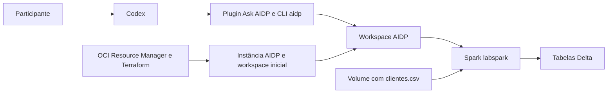
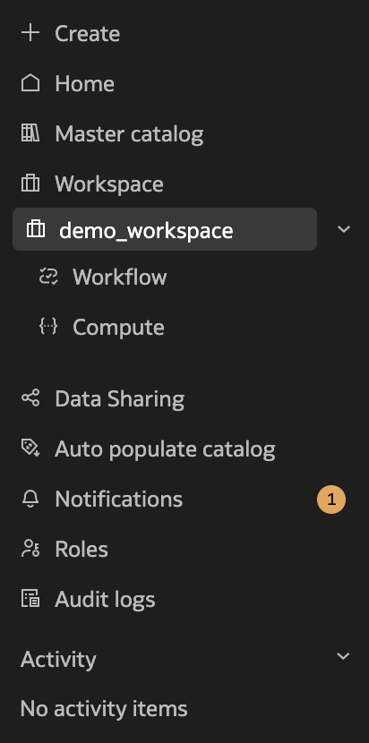
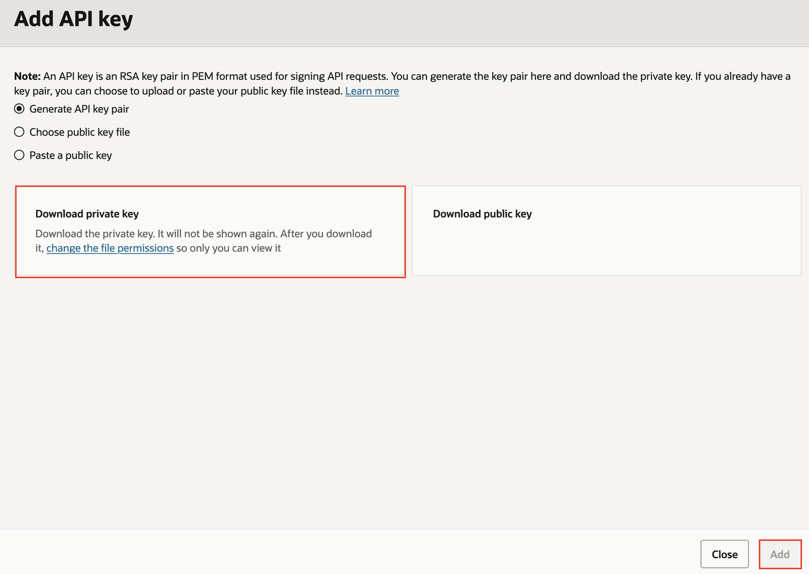
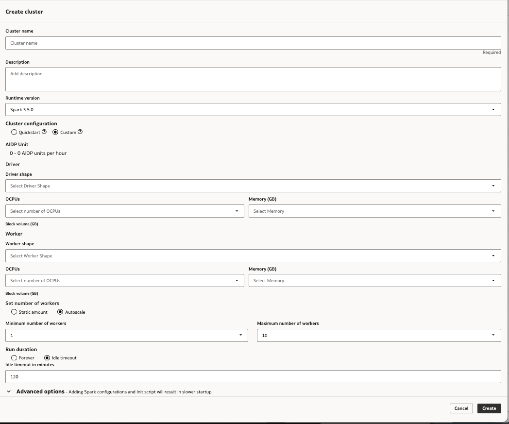
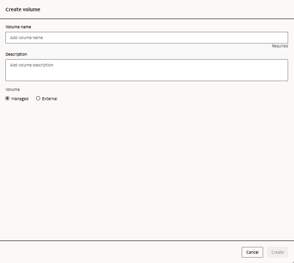
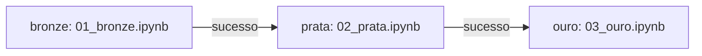
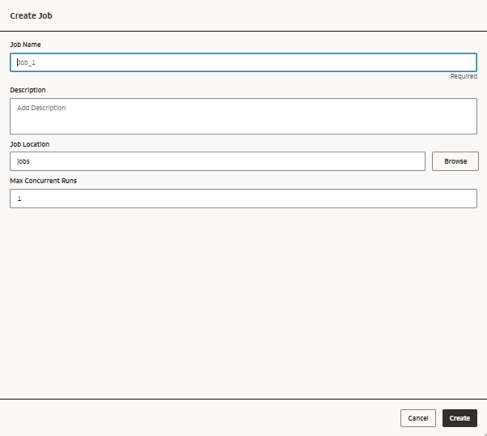
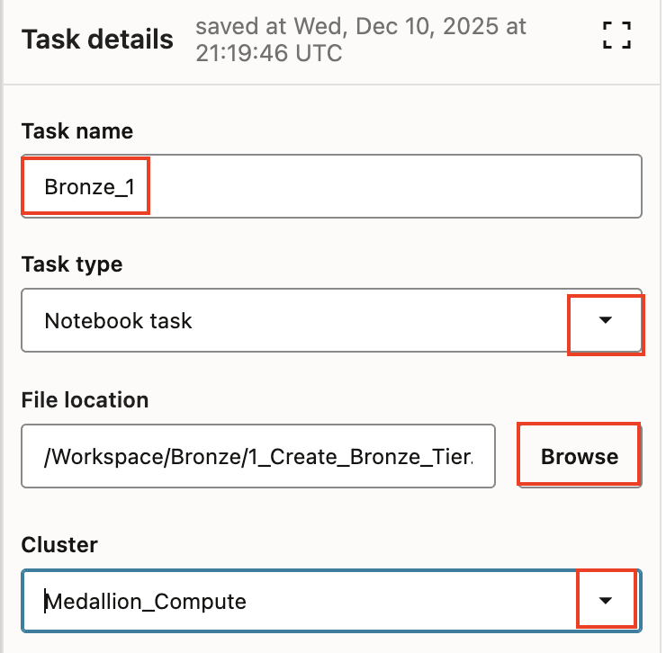
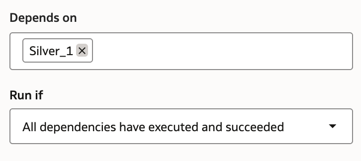
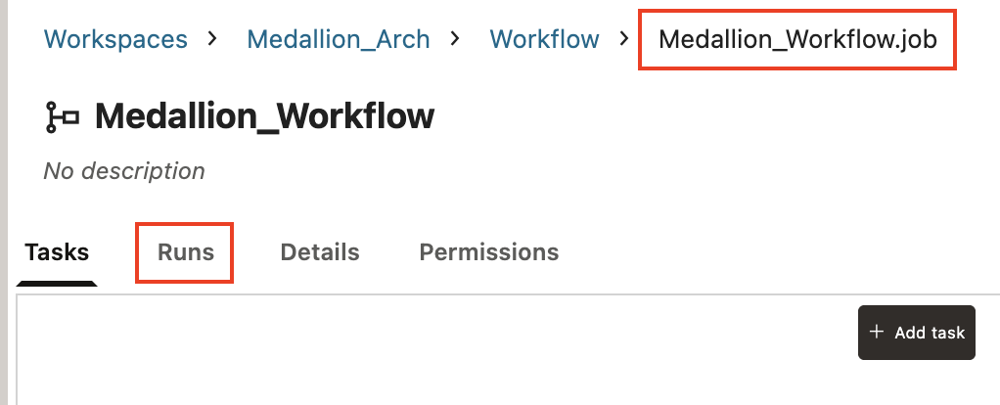

# Workshop: Codex + Oracle AI Data Platform

Tutorial do participante para criar um pipeline de dados com **bronze, prata e ouro** no Oracle AI Data Platform (AIDP), usando o Codex e o plugin Ask AIDP. A infraestrutura inicial roda na sua conta OCI, com Terraform pelo Resource Manager.

Ao terminar, você terá três notebooks, sete tabelas e um job com tarefas dependentes. Executará o mesmo job duas vezes para verificar que a carga não duplica os resultados.

> **Como acompanhar:** envie um prompt por vez no mesmo chat do Codex. Espere a conclusão, confira o resultado indicado e só então avance. Os valores das propostas são fictícios.

## Navegação

1. [Preparação e materiais](#preparacao)
2. [Conta OCI e infraestrutura com Terraform](#infraestrutura)
3. [Computador, plugin e pacotes Oracle](#computador)
4. [API Key e conexão ao workspace](#conexao)
5. [Spark Compute](#spark)
6. [Execução: fonte, bronze, prata e ouro](#laboratorio)
7. [Job e reexecução](#job)
8. [Evidências e encerramento](#encerramento)
9. [Limpeza do ambiente](#limpeza)
10. [Ajuda e referências](#ajuda)

<a id="preparacao"></a>

## 1. Preparação e materiais

### Antes da sessão

- Tenha acesso ao aplicativo com Codex e permissão para instalar Node.js, Git e os componentes Oracle no computador.
- Ative sua própria conta OCI conforme a orientação da organização. Confira promoção, saldo, validade e disponibilidade do AIDP na região **Chicago (`us-chicago-1`)**.
- Use um usuário autorizado a criar a stack, compartments, policies e instância AIDP. As policies do pacote autorizam o serviço AIDP e não concedem permissões ao seu usuário.
- Separe os arquivos deste repositório. Para obter tudo pelo GitHub, use **Code > Download ZIP** e extraia a pasta localmente.

O Resource Manager executa o Terraform na OCI. Você não precisa instalar Terraform ou Python localmente para seguir o fluxo principal. A CLI `aidp` será instalada no computador durante a preparação.

### Arquivos do workshop

| Arquivo ou pasta | Uso |
| --- | --- |
| [Terraform.zip](Terraform.zip) | Pacote original para upload no OCI Resource Manager |
| [terraform/](terraform/) | Código legível da infraestrutura e orientação técnica |
| [clientes.csv](clientes.csv) | Fonte fictícia, com 100 linhas de dados e 11 colunas |
| [exemplos/ambiente-lab.example.json](exemplos/ambiente-lab.example.json) | Modelo sem dados reais da configuração local |
| [Resultados esperados](resultados-esperados.md) | Contagens, regras e indicadores de referência |
| [Solução de problemas](solucao-de-problemas.md) | Diagnóstico de instalação, acesso, execução e dados |
| [Apresentação convertida](apresentacao-convertida.md) | Conteúdo textual dos 50 slides, na ordem original |

As imagens deste tutorial são prints da documentação oficial e mostram ambientes de exemplo. Use os nomes e valores escritos nas etapas. [Fontes das imagens](fontes-das-imagens.md).

### O papel de cada componente



| Criado pelo Terraform | Criado depois pelo Codex e Ask AIDP |
| --- | --- |
| Compartment `lab_codex_aidp_rm` | Spark Compute `labspark` |
| Policies do serviço AIDP | Pasta, schema e volume |
| Instância `lab-codex-aidp-rm` | Upload do CSV e notebooks |
| Workspace inicial `lab-validacao` | Tabelas e job `job_clientes` |
| Lakehouse, se habilitado | Execuções e consulta de resultados |

### Nomes usados no exercício

Cada participante usa sua própria conta. Os mesmos nomes podem ser usados nessas contas independentes. Se o facilitador fornecer um ambiente compartilhado, defina com ele destinos exclusivos e ajuste os prompts antes de executar.

| Objeto | Valor |
| --- | --- |
| Região | `us-chicago-1` |
| Instância AIDP | `lab-codex-aidp-rm` |
| Workspace | `lab-validacao` |
| Spark Compute | `labspark` |
| Catálogo | `default`, do tipo standard |
| Schema | `lab_clientes` |
| Volume managed | `entrada` |
| Pasta remota | `/Workspace/Shared/lab_clientes` |
| CSV no Spark | `/Volumes/default/lab_clientes/entrada/clientes.csv` |
| Job | `job_clientes` |

<a id="infraestrutura"></a>

## 2. Conta OCI e infraestrutura com Terraform

Referência na apresentação: slides 7 a 16.

### 2.1 Ative e confira a conta

1. Use o link fornecido pela organização ou o [cadastro público da Oracle Cloud](https://signup.oraclecloud.com).
2. Complete o cadastro e a validação de e-mail. Confira a disponibilidade de Chicago antes de definir a home region.
3. Depois da ativação, entre no Console OCI, confira a tenancy e selecione **Chicago (`us-chicago-1`)**.
4. Consulte a validade e o saldo da promoção. Acesse o serviço **AI Data Platform** e confira **Limits, Quotas and Usage**.
5. Se faltar região, permissão ou capacidade, registre a mensagem e procure o facilitador antes de provisionar.

### 2.2 Crie uma stack

1. No Console OCI, abra **Developer Services > Resource Manager > Stacks**.
2. Selecione um compartment já existente, como a raiz da sua trial. A stack deve ficar fora do compartment descartável que o Terraform criará.
3. Clique em **Create stack**, selecione **My configuration** e envie **`Terraform.zip`** deste repositório.
4. Use o ZIP interno de Terraform. O ZIP baixado do GitHub contém todo o tutorial e deve ser extraído antes de localizar `Terraform.zip`.
5. Se houver o campo **Working directory**, use a raiz (`.`). Os arquivos `.tf` já estão na raiz do pacote.
6. Selecione **Terraform 1.5.x** e confira os parâmetros abaixo.

| Parâmetro | Valor do workshop |
| --- | --- |
| `tenancy_ocid` | Tenancy da sua conta, preenchida pelo Console |
| `region` | `us-chicago-1` |
| `lab_name` | `lab-codex-aidp-rm` |
| `workspace_name` | `lab-validacao` |
| `enable_ai_features` | `false`, opção de Lakehouse desmarcada |
| `iam_wait_seconds` | `90`, mantenha o padrão |

O laboratório usa Spark e dispensa o Lakehouse opcional. Ao habilitá-lo, o pacote provisiona Lakehouse 26ai com 2 ECPUs e 1 TB, o que consome créditos adicionais. Em uma stack já iniciada, preserve a escolha e revise qualquer alteração no Plan.

O pacote fixa Terraform `~> 1.5.0` e provider OCI `9.11.0`. A [documentação do Resource Manager](https://docs.oracle.com/en-us/iaas/Content/ResourceManager/Reference/terraformversions.htm) inclui Terraform 1.5.x. Os requisitos de [estrutura do ZIP](https://docs.oracle.com/en-us/iaas/Content/ResourceManager/Concepts/terraformconfigresourcemanager.htm) explicam a raiz e a ausência de state no upload.

### 2.3 Execute Plan e Apply

1. Conclua a criação da stack e execute **Plan**.
2. Confira região, nomes e recursos previstos. Acompanhe as ações de criação, alteração e exclusão do plano.
3. Depois da revisão, execute **Apply** e aguarde o job terminar com sucesso.
4. Se ocorrer falha, abra os logs, corrija a configuração e tente novamente na **mesma stack**, preservando seu state.

> Ao retomar uma tentativa, use a stack existente. Criar outra stack pode gerar recursos duplicados e dificultar a limpeza.

### 2.4 Guarde os Outputs e abra o Workbench

Nos detalhes da stack/job de Apply, abra **Outputs** e anote localmente:

| Output | Próximo uso |
| --- | --- |
| `aidp_instance_id` | Identificação da sua instância na conexão do plugin |
| `region` | Deve corresponder a `us-chicago-1` |
| `workspace_name` | Deve corresponder a `lab-validacao` |
| `console_url` | Link para localizar o serviço no Console |
| `compartment_id` | Identificação do compartment para conferência e limpeza |

Guarde também o nome e o link da stack. Abra a instância `lab-codex-aidp-rm`, confira o estado **ACTIVE** e abra o **Workbench**. Em **Workspaces**, localize `lab-validacao` e confirme o catálogo standard `default`.



*Print de referência da Oracle. Localize o workspace `lab-validacao` criado na sua conta.*

**Conferência antes de avançar:** Apply concluído, instância ativa, workspace acessível e Outputs guardados. O `workspaceKey` será consultado pelo plugin. O `clusterKey` será obtido após criar o Spark.

<a id="computador"></a>

## 3. Computador, plugin e pacotes Oracle

Referência na apresentação: slides 18 a 23.

### 3.1 Abra o projeto no Codex

1. Instale o aplicativo pelo [download oficial](https://chatgpt.com/download). Abra o aplicativo, entre na sua conta e acesse o Codex. Consulte o [guia oficial do aplicativo](https://learn.chatgpt.com/app) se precisar localizar o acesso.
2. Use a pasta extraída deste repositório como projeto local, ou copie seu conteúdo para uma pasta `Lab-Codex-AIDP` em Documentos.
3. Confira que `clientes.csv` está na raiz dessa pasta.
4. Abra a pasta como projeto no Codex e inicie um chat local.

### 3.2 Instale e confira Node.js e Git

Instale a versão LTS do [Node.js](https://nodejs.org/en/download), com npm, e o [Git](https://git-scm.com/downloads), se ainda estiverem ausentes. Abra um novo Terminal no macOS ou PowerShell no Windows e execute um comando por vez:

```shell
node --version
npm --version
git --version
```

Os três devem retornar uma versão. Se o aplicativo estava aberto durante a instalação, feche-o por completo e abra novamente para que encontre as ferramentas.

### 3.3 Adicione o marketplace Oracle e instale Ask AIDP

No Codex, abra **Plugins** e a opção de adicionar marketplace. Preencha:

| Campo | Valor |
| --- | --- |
| Source | `oracle-samples/oracle-aidp-samples` |
| Git ref | `main` |
| Sparse paths, linha 1 | `.agents` |
| Sparse paths, linha 2 | `ai/codex-plugins` |

Adicione o marketplace, localize **Ask AIDP**, instale e habilite o plugin. Feche o aplicativo por completo, reabra e inicie um novo chat no mesmo projeto.

Se sua versão não mostrar esse formulário, envie ao Codex este pedido de instalação:

```text
Instale o plugin Ask AIDP a partir do repositório oficial:
https://github.com/oracle-samples/oracle-aidp-samples/tree/main/ai/codex-plugins/plugins/ask-aidp
Use o fluxo de instalação disponível neste aplicativo.
Ao concluir, informe como verificar se o plugin está instalado e habilitado.
```

O [README oficial do plugin](https://github.com/oracle-samples/oracle-aidp-samples/tree/main/ai/codex-plugins/plugins/ask-aidp) descreve a instalação e as dependências. A [documentação de plugins da OpenAI](https://learn.chatgpt.com/plugins) explica instalação e disponibilidade nas interfaces suportadas.

### 3.4 Baixe os pacotes Oracle

O material deste workshop usa a release **v1.0.0** do SDK/CLI. Na [release oficial v1.0.0](https://github.com/oracle/aidataplatform-sdk/releases/tag/v1.0.0), baixe:

- `aidp-typescript-client-1.0.0.zip`
- `aidp-npm-cli-1.0.0.zip`

Extraia ambos em Downloads. Dentro deles, o Codex localizará os pacotes `.tgz`. Instalar o plugin e instalar a CLI `aidp` são etapas separadas.

Existem [releases posteriores](https://github.com/oracle/aidataplatform-sdk/releases). Use a versão combinada com o facilitador e mantenha CLI e SDK da mesma release. Se uma operação não existir na versão instalada, registre a incompatibilidade antes de mudar versões.

**Prompt P01 — instalação assistida**

Copie somente o bloco abaixo.

```text
Prepare este computador para o laboratório usando Ask AIDP.
Verifique Node.js, npm e a instalação do plugin.
Localize em Downloads os pacotes .tgz extraídos da release Oracle v1.0.0.

Instale aidp-cli, aidp-typescript-client e oci-common em uma pasta
do meu usuário, por exemplo .aidp/lab-tools/runtime, fora do projeto Git.
Localize a raiz instalada do plugin Ask AIDP que contém
mcp/ask-aidp-server.mjs. Instale nela, com --no-save,
oci-common e o mesmo pacote aidp-typescript-client.

Valide o executável aidp com --help e a resolução das dependências
na raiz real do plugin. Informe versões e o caminho absoluto do executável.
Esse caminho será salvo como aidpBin em ambiente-lab.json.
Se precisar usar variável de ambiente, o nome lido pelo plugin é AIDP_CLI_BIN.
No Windows, considere npm.cmd e aidp.cmd. Não instale a CLI do Codex.
Não configure credenciais nem crie recursos de nuvem nesta etapa.
Ao concluir, mostre o resultado e aguarde meu próximo prompt.
```

**Conferência:** o executável `aidp` responde a `--help`, o plugin encontra `oci-common` e `aidp-typescript-client` e o Codex informa o caminho absoluto da CLI. Ter acesso à ajuda do plugin, por si só, não comprova que a CLI está instalada.

O kit original chama esse caminho de `AIDP_BIN`. Neste tutorial ele fica no campo **`aidpBin`** da configuração. A variável de ambiente reconhecida pelo plugin é **`AIDP_CLI_BIN`**.

<a id="conexao"></a>

## 4. API Key e conexão ao workspace

Referência na apresentação: slides 24 a 26.

### 4.1 Cadastre uma API Key no seu usuário OCI

1. No Console OCI, abra o perfil do usuário que terá acesso ao laboratório.
2. Em **API Keys**, selecione **Add API Key** e gere um par de chaves.
3. Baixe a chave privada, conclua o cadastro da chave pública e copie o trecho de configuração exibido pela OCI.
4. Anote o caminho absoluto do PEM no computador.

Cole no próximo prompt somente o trecho de configuração e o caminho do arquivo. **O conteúdo da chave privada permanece no computador.** O Resource Manager não precisa receber essa chave.



*Selecione Generate API key pair e baixe a chave privada antes de concluir o cadastro. O print mostra somente a interface de exemplo.*

Siga as [instruções de API signing keys da Oracle](https://docs.oracle.com/en-us/iaas/Content/API/Concepts/apisigningkey.htm). Esta variante usa `api_key`; a senha do Console e uma eventual senha ADMIN do Lakehouse têm outras funções.

**Prompt P02 — perfil OCI**

Copie somente o bloco abaixo.

```text
Configure a autenticação OCI do laboratório no meu computador.
Use o trecho gerado no cadastro da minha API Key:
<TRECHO_DE_CONFIGURACAO_FORNECIDO_PELA_OCI>

Chave privada: <CAMINHO_ABSOLUTO_DO_ARQUIVO_PEM>.
Crie o arquivo config-lab-aidp dentro de .oci na pasta do meu usuário,
fora deste repositório. Use o perfil [LAB_AIDP] e ajuste key_file.
Use region=us-chicago-1, conforme o Output region da stack.
Preserve os demais perfis e restrinja o acesso à configuração e à chave.

Use auth=api_key e informe o caminho absoluto do arquivo de configuração.
Confira a existência da chave sem imprimir seu conteúdo.
Não publique arquivos de autenticação no Git.
Ao concluir, mostre o resultado e aguarde meu próximo prompt.
```

**Conferência:** perfil `[LAB_AIDP]`, região `us-chicago-1`, `key_file` apontando para o PEM existente e acesso restrito. O arquivo fica em `~/.oci/config-lab-aidp` no macOS/Linux ou `%USERPROFILE%\.oci\config-lab-aidp` no Windows, fora do repositório.

### 4.2 Resolva o workspace e salve a configuração local

Substitua `<OCID_DA_MINHA_INSTANCIA>` pelo Output `aidp_instance_id` da sua stack. Copie o OCID inteiro, sem usar o exemplo de outra pessoa.

**Prompt P03 — conexão ao workspace**

Copie somente o bloco abaixo.

```text
Use Ask AIDP com meu perfil LAB_AIDP no arquivo config-lab-aidp
da pasta .oci do meu usuário. Localize a CLI aidp e as dependências do plugin.
Output aidp_instance_id: <OCID_DA_MINHA_INSTANCIA>.
Output region: us-chicago-1. Workspace: lab-validacao.

Passe aidpBin, configFile, profile, auth=api_key, region e instanceId
explicitamente no parâmetro config das ferramentas, sem usar defaults
de outro ambiente. Consulte essa instância e resolva o workspaceKey real.
Confirme o catálogo standard default. Não crie recursos nesta etapa.

Salve ambiente-lab.json na raiz do projeto com aidpBin, configFile,
profile, auth, region, instanceId e workspaceKey, usando caminhos absolutos,
sem senhas nem conteúdo da chave. O clusterKey será preenchido depois.
Nas próximas chamadas, leia esse arquivo e repasse os valores em config.
O plugin não carrega ambiente-lab.json automaticamente.
Se existir configuração de outro ambiente, informe a diferença antes de alterar.
Ao concluir, mostre o resultado e aguarde meu próximo prompt.
```

**Conferência:** a consulta real retorna a instância correta, o `workspaceKey` de `lab-validacao` e o catálogo `default`. Abra o JSON salvo e compare os identificadores com o ambiente da sua conta. O arquivo [de exemplo](exemplos/ambiente-lab.example.json) mostra a estrutura, com campos fictícios.

O JSON serve como memória local para o Codex. Ele precisa ler o arquivo e passar esses valores às ferramentas do plugin. A simples existência do JSON não muda a configuração do plugin. Mantenha `auth=api_key` explícito para evitar o uso de outro modo de autenticação por padrão.

<a id="spark"></a>

## 5. Spark Compute

Referência na apresentação: slide 27.

Crie ou reutilize um único compute `labspark` no workspace correto:

| Configuração | Valor |
| --- | --- |
| Tipo | `USER` |
| Spark | `3.5.0` |
| Shape | AMD compatível, validado no ambiente |
| Driver | 2 OCPUs e 32 GB |
| Workers | 1 worker fixo, 2 OCPUs e 32 GB |
| Autoscaling | Desabilitado |
| Idle timeout | 15 minutos |



*O exemplo da Oracle mostra Autoscale de 1 a 10 e timeout de 120 minutos. No workshop, selecione **Static amount = 1**, timeout de **15 minutos** e driver/worker AMD com **2 OCPUs e 32 GB**. Confira também Spark **3.5.0**. Clique na imagem para ampliar se necessário.*

**Prompt P04 — Spark**

Copie somente o bloco abaixo.

```text
Leia ambiente-lab.json e use Ask AIDP, passando seus valores em config.
Consulte a ajuda da CLI instalada.
Procure labspark no workspace configurado. Crie somente se estiver ausente.
Se houver nomes duplicados ou configuração diferente, informe e pare.

Configuração: cluster USER, Spark 3.5.0 e shape AMD compatível.
Driver: 2 OCPUs e 32 GB. Um worker fixo: 2 OCPUs e 32 GB.
Sem autoscaling. Idle timeout: 15 minutos. Confira as opções suportadas.
Se indisponíveis, pare antes de substituir versão, shape ou capacidade.

Reutilize o cluster compatível e inicie-o se estiver parado.
Em criação ou após timeout, acompanhe a mesma solicitação antes de repetir.
Aguarde ACTIVE, confira a configuração e salve clusterKey em ambiente-lab.json.
Limite esta etapa ao compute. Não crie dados, notebooks ou workflows.
Ao concluir, mostre o resultado e aguarde meu próximo prompt.
```

**Conferência:** compute em **ACTIVE**, configuração confirmada e `clusterKey` salvo no JSON. O Default Master Catalog Compute atende ao catálogo e não substitui o compute USER dos notebooks.

Se versão, shape ou capacidade não estiverem disponíveis, registre o impedimento e peça orientação ao facilitador. Após timeout, consulte a solicitação/cluster existente antes de tentar criar novamente. A [API de criação de clusters](https://docs.oracle.com/en/cloud/paas/ai-data-platform/aiwap/op-aidataplatforms-aidataplatformid-workspaces-workspacekey-clusters-post.html) documenta a operação assíncrona e seus identificadores.

<a id="laboratorio"></a>

## 6. Execução do laboratório

Referência na apresentação: slides 29 a 41.

### 6.1 Estabeleça o contexto

Este primeiro pedido só confirma o entendimento. Os recursos de dados serão criados nas etapas seguintes.

**Prompt L01 — contexto**

Copie somente o bloco abaixo.

```text
Esta mensagem serve apenas para estabelecer o contexto do laboratório.
Leia somente o arquivo local ambiente-lab.json para conhecer a configuração.

Workspace: lab-validacao. Spark Compute: labspark.
Catálogo: default. Schema: lab_clientes.
Pasta: /Workspace/Shared/lab_clientes.
CSV local: clientes.csv na pasta deste projeto.

Nesta etapa, não crie, altere ou execute recursos, notebooks ou workflows.
Responda com um resumo do entendimento e aguarde meu próximo prompt.
Nas etapas futuras, execute apenas o pedido da mensagem atual.
Ao terminar cada etapa, apresente os resultados e aguarde a próxima.
Preserve os dados de origem e mantenha credenciais fora das respostas.
```

**Conferência:** resposta com os nomes e destinos corretos e indicação de que aguardará a próxima etapa.

### 6.2 Verifique conexão e arquivo local

**Prompt L02 — verificação**

Copie somente o bloco abaixo.

```text
Leia ambiente-lab.json e verifique instância, workspace e labspark.
Se o compute estiver parado, inicie apenas o cluster configurado.

Execute SELECT 1 AS teste nesse Spark e mostre a saída real.
Se precisar de notebook, use somente 00_verificacao.ipynb na pasta
/Workspace/Shared/lab_clientes. Crie a pasta se necessário.
Se a ferramenta exigir workflow auxiliar, limite-o a esse teste.

Confira o clientes.csv local e informe a contagem e os 11 nomes de coluna.
Não crie nem execute os notebooks bronze, prata e ouro nesta etapa.
Ao concluir, mostre o resultado e aguarde meu próximo prompt.
```

**Conferência:** a saída de `SELECT 1 AS teste` contém `teste = 1`. O CSV contém 100 linhas de dados, além do cabeçalho, e os 11 campos listados na [referência de dados](resultados-esperados.md).

O notebook `00_verificacao.ipynb`, se necessário, é auxiliar. Os três notebooks do pipeline começam na etapa 6.4.

### 6.3 Crie os destinos e envie o CSV



*Print de referência. O prompt cria ou reutiliza o volume managed `entrada` em `default.lab_clientes`. Confira esse destino no Workbench.*

**Prompt L03 — schema, volume e fonte**

Copie somente o bloco abaixo.

```text
Crie /Workspace/Shared/lab_clientes e o schema default.lab_clientes
se ainda não existirem. Crie ou reutilize o volume managed entrada.

Envie o clientes.csv local para esse volume, preservando o conteúdo.
Se o destino já existir, compare o conteúdo antes de substituir.
Confirme o envio pela listagem e pela leitura no Spark.

URI esperada: /Volumes/default/lab_clientes/entrada/clientes.csv
Valide 100 linhas, 11 colunas e 95 conteúdos distintos.
Informe a URI real como URI_CSV. Use o notebook auxiliar se necessário.
Limite esta etapa aos destinos e à fonte. Ainda não crie as três camadas.
Ao concluir, mostre o resultado e aguarde meu próximo prompt.
```

**Conferência:** a listagem do volume e a leitura pelo Spark encontram o mesmo arquivo. A URI fica em uma única linha:

```text
/Volumes/default/lab_clientes/entrada/clientes.csv
```

Uma pasta do computador e uma pasta do Workbench são destinos diferentes. O caminho local `clientes.csv` precisa de upload para ficar disponível ao Spark nesse volume.

### 6.4 Crie e execute a bronze

A bronze preserva a origem: 100 linhas, valores textuais, zeros à esquerda e cópias idênticas. Metadados de carga ficam em colunas adicionais. A deduplicação posterior considera somente os 11 campos de origem.

**Prompt L04 — bronze**

Copie somente o bloco abaixo.

```text
Crie 01_bronze.ipynb em /Workspace/Shared/lab_clientes.
Leia /Volumes/default/lab_clientes/entrada/clientes.csv e grave a tabela Delta
default.lab_clientes.bronze_clientes.

Leia os 11 campos como texto, preservando zeros à esquerda,
valores originais, campos vazios e as 100 linhas, inclusive duplicatas.
Use nomes de coluna compatíveis com Delta e registre o mapeamento.
Registre a URI de origem em uma coluna de metadados.
Calcule um hash SHA-256 da serialização estruturada dos 11 campos
originais em ordem fixa, preservando a distinção entre vazio e nulo.
Configure a leitura CSV para preservar campos vazios e não inferir tipos.

Execute no Spark informado e consulte a tabela persistida.
Reexecuções devem substituir apenas a carga deste exercício.
Informe status final, contagens e caminho do notebook.
Exiba LAB_BRONZE_VALIDADO com as contagens reais.
Use células curtas, comentários e validações. Execute somente esta camada.
Ao concluir, mostre o resultado e aguarde meu próximo prompt.
```

**Conferência:** `default.lab_clientes.bronze_clientes` tem 100 linhas e 95 conteúdos originais distintos. O notebook executado mostra estado final e o marcador `LAB_BRONZE_VALIDADO` com contagens reais.

### 6.5 Crie e execute a prata

Remova cópias idênticas pelos **11 valores originais antes de normalizar**. Os códigos `018`, `037` e `094` pertencem a registros diferentes nesta fonte: esses seis registros permanecem e recebem sinalização de colisão.

| Dado | Regra |
| --- | --- |
| Cópias idênticas | Remover só as cópias excedentes e registrá-las na auditoria |
| Código | Manter como texto, inclusive vazios, sem completar zeros automaticamente |
| Status | Padronizar caixa/espaços, corrigir `Inatvo` e normalizar ausentes |
| E-mail | Ajustar espaços e caixa, preservando original e indicação de formato |
| Telefone | Validar formato, preservando original e critério usado |
| Indicadores numéricos | Converter com controle de ausente e formato inválido |
| Desfecho em 30 dias | `Sim` = verdadeiro, `Não` = falso, `Não se aplica` = nulo |

**Prompt L05 — prata**

Copie somente o bloco abaixo.

```text
Crie e execute 02_prata.ipynb em /Workspace/Shared/lab_clientes,
a partir da bronze, no schema default.lab_clientes.
Grave prata_clientes; mantenha registros inválidos e originais para auditoria.
Remova só cópias idênticas nos 11 campos originais, antes de padronizar.
Registre grupos duplicados em prata_auditoria_duplicatas com
quantidade_excedente = quantidade_original - 1. A soma esperada é 5.
Preserve códigos como texto e vazios, sem completar zeros automaticamente.
Grave colisões em prata_colisoes_codigo, sem excluir esses registros.

Ajuste espaços e e-mails em minúsculas; valide formatos de e-mail/telefone.
Converta indicadores numéricos; diferencie ausentes de formatos inválidos.
Status: Ativo/ATIVO/ativo com espaços → Ativo; Inatvo → Inativo.
Em negociacao → Em negociação; vazio/N/A → Não informado.
Desfecho: Sim → verdadeiro; Não → falso; Não se aplica → nulo.
Considere colisão somente para códigos preenchidos. Preserve os seis
registros de código vazio, sem tratá-los como outro código em colisão.
Reexecuções devem substituir somente as tabelas deste exercício,
incluindo auditoria e colisões, sem append e sem afetar outros destinos.
Confira as tabelas: 95 registros e 6 com colisão em 3 códigos.
Use células curtas, comentários e validações. Execute somente esta camada.
Ao concluir, mostre o resultado e aguarde meu próximo prompt.
```

**Conferência:** `prata_clientes` tem 95 registros. A soma de `quantidade_excedente` em `prata_auditoria_duplicatas` é 5. `prata_colisoes_codigo` preserva os seis registros dos três códigos em colisão. A bronze permanece com 100 linhas.

### 6.6 Crie e execute a ouro

A ouro responde às perguntas do exercício com três tabelas: `ouro_resumo`, `ouro_por_status` e `ouro_por_empresa`.

**Prompt L06 — ouro**

Copie somente o bloco abaixo.

```text
Crie e execute 03_ouro.ipynb em /Workspace/Shared/lab_clientes
usando default.lab_clientes.prata_clientes.
Grave ouro_resumo, ouro_por_status e ouro_por_empresa
no schema default.lab_clientes.

Calcule total de registros, conversões, não conversões
e casos com resultado Não se aplica.
Calcule a conversão como Sim / (Sim + Não).
Exclua Não se aplica apenas desse denominador e trate divisão por zero.

Inclua o valor total das propostas com tipo decimal, identificado como fictício.
Mantenha empresa ausente em um grupo próprio.
Reexecuções devem substituir somente as tabelas ouro deste exercício,
sem append e sem afetar outros destinos.
Confira os totais das agregações contra a prata.
Informe o estado final e os resultados reais das tabelas gravadas.
Use células curtas, comentários e validações. Execute somente esta camada.
Ao concluir, mostre o resultado e aguarde meu próximo prompt.
```

**Conferência:**

| Indicador | Referência |
| --- | ---: |
| Registros na prata | 95 |
| Resultado Sim | 27 |
| Resultado Não | 30 |
| Resultado Não se aplica | 38 |
| Casos aplicáveis | 57 |
| Conversão em 30 dias | **47,37%** |
| Valor total fictício das propostas | R$ 3.132.500,00 |

```text
Conversão = Sim / (Sim + Não) × 100
          = 27 / (27 + 30) × 100
          = 47,37%
```

Os 38 casos “Não se aplica” continuam na base e ficam fora somente do denominador da conversão. Status atual e desfecho em 30 dias são campos diferentes.

### 6.7 Faça perguntas com consulta real

**Prompt L07 — perguntas sobre os dados**

Copie somente o bloco abaixo.

```text
Consulte as tabelas ouro deste participante e responda:

1. Quantos registros estão ativos, inativos, em negociação
   ou com status não informado?
2. Qual é a conversão em 30 dias? Mostre numerador e denominador.
3. Qual empresa concentra o maior valor de propostas?
   Sinalize que os valores comerciais são fictícios.

Execute as consultas no AIDP.
Mostre a tabela consultada, os critérios e os resultados retornados.
Diferencie status atual de resultado de conversão em 30 dias.
Ao concluir, mostre o resultado e aguarde meu próximo prompt.
```

Compare a resposta com esta referência calculada sobre o CSV:

| Status atual | Registros |
| --- | ---: |
| Ativo | 38 |
| Inativo | 24 |
| Em negociação | 20 |
| Não informado | 13 |
| **Total** | **95** |

A empresa **Sol Nascente** concentra o maior valor fictício de propostas: **R$ 362.000,00**, em nove registros. A resposta do Codex deve trazer a consulta e a saída real do seu AIDP, permitindo comparação com essa referência.

<a id="job"></a>

## 7. Job e reexecução

Referência na apresentação: slides 42 a 45.

### 7.1 Configure dependências e execute uma vez





*Print de referência da criação de um job. No exercício, use `job_clientes` e selecione `labspark` nas tarefas.*

**Prompt L08 — job com dependências**

Copie somente o bloco abaixo.

```text
Crie ou reutilize o job job_clientes neste workspace.
Se houver um único job compatível, reutilize-o.
Se houver nomes duplicados ou configuração diferente, informe e pare.
Configure três tarefas: bronze, prata e ouro.

A tarefa bronze executa 01_bronze.ipynb.
A prata executa 02_prata.ipynb somente após sucesso da bronze.
A ouro executa 03_ouro.ipynb somente após sucesso da prata.
Use o Spark Compute informado e os mesmos destinos dos notebooks.

Execute o job uma vez.
Acompanhe até o estado final e consulte a saída de cada tarefa.
Informe as dependências, o resultado e a duração.
Não crie agendamento recorrente.
Ao concluir, mostre o resultado e aguarde meu próximo prompt.
```

Confira os detalhes de cada tarefa na interface:



*No exemplo aparecem `Bronze_1` e `Medallion_Compute`. Para este workshop, a tarefa `bronze` usa `/Workspace/Shared/lab_clientes/01_bronze.ipynb` e o compute `labspark`. Configure `prata` e `ouro` com seus respectivos notebooks.*



*O print usa `Silver_1` como exemplo. Neste workshop, `prata` depende de `bronze` e `ouro` depende de `prata`, com a condição de que todas as dependências tenham terminado com sucesso.*

**Conferência:** três tarefas, cada uma apontando para o notebook correto, com prata dependente de bronze e ouro dependente de prata. Aguarde o estado final de sucesso de todas as tarefas e registre job ID, run ID e duração.

### 7.2 Reexecute o mesmo job

**Prompt L09 — reexecução**

Copie somente o bloco abaixo.

```text
Reexecute o mesmo job uma vez, sem criar outro job.
Acompanhe o estado final das três tarefas.

Confira novamente as contagens da bronze, da prata e da auditoria,
os códigos em colisão e os indicadores da ouro.

Compare com a primeira execução.
Confirme que os totais não dobraram e que os destinos continuam
na pasta e no schema exclusivos deste participante.

Informe qualquer diferença e a duração da segunda execução.
Ao concluir, mostre o resultado e aguarde meu próximo prompt.
```

**Conferência:** as duas execuções têm run IDs distintos e pertencem ao mesmo job. As contagens continuam em 100 na bronze, 95 na prata e 5 cópias excedentes na auditoria. Conversão e agregações permanecem iguais.

Esse resultado verifica a estabilidade da carga para o mesmo arquivo. Se os totais dobrarem, confira o modo de escrita e os destinos antes de continuar.

### 7.3 Confira os resultados também pela interface

No Workbench:

1. Abra **Workspaces > lab-validacao** e localize **Shared > lab_clientes**.
2. Abra os três notebooks e confira a saída das células e o compute usado.
3. Em **Workflows**, abra `job_clientes`, a aba **Runs** e os detalhes das tarefas de cada execução.
4. Em **Master catalog > default > lab_clientes**, confira as tabelas e suas consultas.



*O print mostra `Medallion_Workflow`. Abra `job_clientes` no seu workspace e use a aba Runs para conferir os dois run IDs.*

Se quiser repetir as conferências de forma explícita, execute estas consultas no Spark do exercício pelo AIDP e compare a saída real:

```sql
SELECT 'bronze' AS camada, COUNT(*) AS registros
FROM default.lab_clientes.bronze_clientes
UNION ALL
SELECT 'prata' AS camada, COUNT(*) AS registros
FROM default.lab_clientes.prata_clientes;

SELECT SUM(quantidade_excedente) AS copias_excedentes
FROM default.lab_clientes.prata_auditoria_duplicatas;

SELECT * FROM default.lab_clientes.ouro_resumo;
SELECT * FROM default.lab_clientes.ouro_por_status;
SELECT * FROM default.lab_clientes.ouro_por_empresa;
```

<a id="encerramento"></a>

## 8. Evidências e encerramento

Referência na apresentação: slides 47 e 48.

Antes de remover recursos, consolide os resultados e exporte os notebooks.

**Prompt E01 — exportação e parada do Spark**

Copie somente o bloco abaixo.

```text
Consolide os resultados reais das duas execuções de job_clientes.
Liste notebooks, tabelas, job ID, run IDs e estados das tarefas.

Confirme bronze com 100 linhas e prata com 95 registros.
Mostre cinco cópias excedentes, três códigos em colisão
com seis registros preservados e conversão 27 / 57 = 47,37%.

Salve o resumo em evidencias/ e exporte os notebooks para
notebooks-exportados/ na pasta local do projeto.
Confirme que os arquivos exportados podem ser abertos.
Depois, pare somente o compute labspark desta conta.
A limpeza via Terraform será na próxima etapa. Não execute Destroy agora.
Ao concluir, mostre o resultado e aguarde meu próximo prompt.
```

### Checklist de conclusão

- [ ] `01_bronze.ipynb`, `02_prata.ipynb` e `03_ouro.ipynb` exportados e abrindo corretamente.
- [ ] Sete tabelas presentes: bronze, prata, auditoria, colisões e três tabelas ouro.
- [ ] Um `job_clientes` com três tarefas dependentes e duas execuções completas.
- [ ] Job ID, run IDs, estados e durações guardados localmente.
- [ ] Contagens conferidas: 100, 95, cinco cópias excedentes e seis registros em colisão.
- [ ] Conversão de 27/57 = 47,37% confirmada por consulta real.
- [ ] Compute `labspark` parado após concluir as execuções.

Para registrar seu próprio workshop, capture a tela de Outputs da stack, configuração do Spark, saída dos notebooks e detalhes das duas execuções. Ao compartilhar essas evidências, remova credenciais e identificadores pessoais. As pastas `evidencias/` e `notebooks-exportados/` ficam fora do Git por padrão.

<a id="limpeza"></a>

## 9. Limpeza do ambiente

Referência na apresentação: slide 49.

Esta etapa remove o ambiente do laboratório. Faça-a depois de guardar os resultados que quer manter.

1. Confirme que não há tarefas em execução, que `labspark` está parado e que os notebooks/evidências foram exportados.
2. Revise no AIDP os dados gerenciados e os recursos internos do exercício, incluindo opções de exclusão de arquivos e dados.
3. No Resource Manager, abra **a mesma stack** usada no provisionamento.
4. Abra **Terraform actions > Destroy**, revise o impacto e execute a remoção.
5. Acompanhe o job e confira os recursos no compartment do laboratório. O state não lista individualmente todos os objetos criados pelo plugin ou pelo próprio serviço.
6. Se a remoção do compartment falhar por resíduos, confira somente buckets/logs pertencentes ao laboratório, siga a orientação do facilitador para removê-los e repita o Destroy na mesma stack.
7. Remova a stack somente após concluir a limpeza. Confira recursos e custos remanescentes no Console.

Parar Spark reduz o consumo do compute, mas outros recursos podem continuar consumindo créditos. Excluir a stack sem executar Destroy não remove a infraestrutura. A variante deste tutorial mantém o state no Resource Manager; use esse fluxo de limpeza.

<a id="ajuda"></a>

## 10. Ajuda e referências

- **Algo falhou?** Abra [Solução de problemas](solucao-de-problemas.md). Guarde mensagem, etapa e ID da solicitação/execução antes de repetir.
- **Quer conferir as regras?** Use [Resultados esperados](resultados-esperados.md). Os números foram recalculados localmente sobre o CSV, para comparação com a sua execução no AIDP.
- **Quer retomar em outro chat?** Abra o mesmo projeto e envie:

```text
Leia somente ambiente-lab.json e confirme o ambiente configurado.
Estou retomando o workshop na etapa <ETAPA_ATUAL>.
Quando eu enviar o próximo prompt, use Ask AIDP com os valores do JSON
passados explicitamente em config. Preserve os recursos existentes.
Agora apenas confirme o entendimento e aguarde.
```

- **Quer validar o CSV localmente?** Se já tiver Python 3, execute opcionalmente:

```shell
python3 scripts/verificar-dados.py
```

- **Quer publicar este tutorial?** Siga o [guia para GitHub](publicacao-github.md).
- **Quer localizar o slide de origem?** Consulte a [conversão dos 50 slides](apresentacao-convertida.md).

### Fontes e versões

Tutorial adaptado de `Apresentacao.pptx`, `Prompts.txt`, `Leia-me.txt`, `clientes.csv` e `Terraform.zip` do kit do workshop. A apresentação original identifica Oracle AI Experience Brasil e Copyright © 2026, Oracle and/or its affiliates.

Revisão documental em **4 de novembro de 2026**. O roteiro mantém as versões do kit: SDK/CLI Oracle v1.0.0, Terraform 1.5.x, provider OCI 9.11.0 e Spark 3.5.0. O marketplace usa `main`, que pode receber atualizações; registre a versão do plugin usada no evento.

Foram conferidos os arquivos, as referências oficiais e os resultados do CSV. A elaboração deste tutorial não inclui uma execução completa de Plan/Apply, notebooks ou Destroy em uma conta OCI. Quotas, permissões, capacidade regional e compatibilidade das ferramentas devem ser confirmadas no ambiente do workshop.

- [Oracle: Ask AIDP](https://github.com/oracle-samples/oracle-aidp-samples/tree/main/ai/codex-plugins/plugins/ask-aidp)
- [Oracle: SDK e CLI](https://github.com/oracle/aidataplatform-sdk)
- [Oracle: release v1.0.0](https://github.com/oracle/aidataplatform-sdk/releases/tag/v1.0.0)
- [Oracle: Resource Manager e estrutura Terraform](https://docs.oracle.com/en-us/iaas/Content/ResourceManager/Concepts/terraformconfigresourcemanager.htm)
- [Oracle: API signing keys](https://docs.oracle.com/en-us/iaas/Content/API/Concepts/apisigningkey.htm)
- [OpenAI: aplicativo](https://learn.chatgpt.com/app)
- [OpenAI: plugins](https://learn.chatgpt.com/plugins)
- [Créditos e fontes dos prints](fontes-das-imagens.md)
